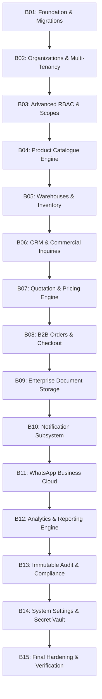

# B00 — Dedicated Backend Development Roadmap (B01–B15)

**Project:** PRIME by Activist — Unified Enterprise Platform  
**Target Backend:** FastAPI + Python 3.12 (Asynchronous)  
**Database:** PostgreSQL 16+ (Production Target)  
**Execution Order:** Sequential, Phase-by-Phase with Verification Gates  
**Audit Baseline Date:** 2026-11-12  

---

## 1. Roadmap Overview & Execution Principles

The dedicated backend roadmap spans fifteen targeted engineering phases (**B01 through B15**). Each phase addresses a specific functional subsystem, establishes repository and service boundaries, implements database migrations, expands automated test coverage, and guarantees seamless integration with the existing Next.js 15 frontend.

### Core Rules of Engagement:
1. **Zero Frontend Regressions:** The Next.js frontend is complete and polished. Backend changes must satisfy existing TypeScript contracts and API proxy expectations.
2. **PostgreSQL Compatibility:** All schema changes and migrations must execute cleanly against PostgreSQL 16+ using asyncpg.
3. **Layered Architecture:** Decompose router files by introducing domain service and repository layers (`app/modules/`, `app/repositories/`).
4. **Test-Driven Delivery:** Every phase requires dedicated pytest regression tests. Phase transition requires a 100% test pass rate.
5. **Alembic-First Database Evolution:** All schema alterations must be applied via reversible Alembic migrations.

---

## 2. Phased Development Roadmap Matrix

---

## 3. Detailed Phase Specifications

### Phase B01 — Core Foundation, Clean Migrations & Database Baseline
- **Objective:** Establish clean PostgreSQL setup, fix Alembic baseline migration gap, and eliminate passlib deprecation warnings.
- **Key Deliverables:**
  - Consolidated initial baseline migration (`0001_initial_core_schema.py`) supporting fresh PostgreSQL initialization.
  - Direct `argon2.PasswordHasher` integration replacing `passlib` to eliminate Python 3.12 deprecations.
  - Fix test defect in `test_security_w11.py` (`/api/v1/admin/users/{id}`).
  - Structured error handling middleware with unified JSON envelope.
- **Verification Gate:** `alembic upgrade head` runs on fresh PostgreSQL; pytest achieves 100% pass rate.

---

### Phase B02 — Organizations & Multi-Tenancy Architecture
- **Objective:** Introduce institutional multi-tenancy for hospitals, pharmaceutical distributors, and government procurement entities.
- **Key Deliverables:**
  - `organizations` table (`id`, `name`, `slug`, `tax_id`, `license_number`, `country`, `status`).
  - `organization_memberships` table (`user_id`, `organization_id`, `role`, `is_primary`).
  - Organization context dependency resolving caller's active tenant.
  - Data isolation: bind orders, quotations, and inquiries to `organization_id`.
- **Verification Gate:** Cross-organization IDOR tests prove complete tenant boundary isolation.

---

### Phase B03 — Advanced RBAC, Granular Scopes & Team Management
- **Objective:** Refactor role-based access control with organization-scoped permissions and team administration.
- **Key Deliverables:**
  - Scoped permissions (e.g. `org:orders.create`, `org:members.invite`).
  - Team member invitation flow with signed token links and email notifications.
  - Migration of `app/api/v1/roles.py` into `app/modules/permissions/service.py`.
- **Verification Gate:** Role inheritance and scoped authorization tests passing.

---

### Phase B04 — Product Formulation Engine, Batch Specifications & Public Catalog
- **Objective:** Elevate catalog management with public product detail routes, formulation compositions, and regulatory dossier indexing.
- **Key Deliverables:**
  - Add public `GET /api/v1/products/{product_id}` endpoint (resolving frontend auth blocker).
  - Add pagination query support (`page`, `limit`) to public product listing.
  - Foreign Key constraint linking `products.category` to `categories.id`.
  - Batch specification models (`dosage_forms`, `packaging_types`).
- **Verification Gate:** Public visitor can browse, filter, paginate, and inspect product details anonymously.

---

### Phase B05 — Warehouses, Batches & Inventory Tracking Subsystem
- **Objective:** Implement complete warehouse and stock management module.
- **Key Deliverables:**
  - Tables: `warehouses`, `inventory_items`, `batches`, `stock_movements`.
  - Batch tracking: expiry dates, manufacture dates, quarantine status, and Certificate of Analysis (COA) linkage.
  - Inventory reserve and release logic during quotation and order lifecycle.
  - API endpoints: `/api/v1/admin/inventory/*`, `/api/v1/admin/warehouses/*`.
- **Verification Gate:** Out-of-stock guards and stock movement audit records verified.

---

### Phase B06 — Commercial Inquiries, Lead Scoring & CRM Pipeline
- **Objective:** Transform basic contact enquiries into an enterprise CRM and lead conversion pipeline.
- **Key Deliverables:**
  - Lead lifecycle states: `New`, `Contacted`, `Qualified`, `Proposal`, `Converted`, `Lost`.
  - One-click inquiry conversion to formal quotation (`POST /api/v1/admin/enquiries/{id}/convert-to-quote`).
  - Customer activity timeline and internal collaborative annotations.
- **Verification Gate:** Inquiry conversion generates pre-populated quotation draft with audit trail.

---

### Phase B07 — Dynamic Quotation Engine, Tiered Pricing & B2B Proposals
- **Objective:** Modernize quotation generation with decimal currency precision, volume discounts, and customer acceptance.
- **Key Deliverables:**
  - Migrate `Quotation.total_amount` and `QuotationItem.unit_price` from `Float` to `Numeric(12, 2)`.
  - Tables: `pricing_tiers`, `volume_discounts`.
  - Customer quote actions: `POST /api/v1/customer/quotations/request` (cart to quote) and `POST /api/v1/customer/quotations/{id}/accept`.
  - PDF quotation proposal generator with institutional branding.
- **Verification Gate:** Decimal calculations verify zero precision drift; customer quote flow tested end-to-end.

---

### Phase B08 — B2B Orders, Customer Checkout & Procurement Lifecycle
- **Objective:** Enable customer-facing online order submission, cart checkout, and shipment tracking.
- **Key Deliverables:**
  - Migrate `Order.total_estimated_amount` from `VARCHAR` to `Numeric(12, 2)`.
  - Customer checkout endpoint: `POST /api/v1/customer/orders` (validates cart, checks stock, creates order).
  - Order state machine transitions with automated inventory reservation.
  - Shipping tracking metadata (carrier, tracking number, dispatch date).
- **Verification Gate:** Customer can submit cart orders online; admin transitions lifecycle cleanly.

---

### Phase B09 — Enterprise Document Storage & Cloud File Management
- **Objective:** Transition local storage into an enterprise-grade file management subsystem with cloud adapter support.
- **Key Deliverables:**
  - Pluggable storage abstraction (`LocalStorageBackend`, `S3StorageBackend`).
  - Streaming chunked file upload with SHA-256 integrity verification.
  - Pre-signed secure download URLs for high-bandwidth documents.
  - Virus scanning hook interface before permanent file persistence.
- **Verification Gate:** Document uploads and signed URL downloads verified under load.

---

### Phase B10 — Asynchronous Notification Subsystem (In-App, Email & Push)
- **Objective:** Build event-driven notification architecture for order updates, quotation approvals, and system alerts.
- **Key Deliverables:**
  - Table: `notifications` (`user_id`, `title`, `body`, `type`, `is_read`, `created_at`).
  - In-app notification endpoints: `GET /api/v1/notifications`, `PATCH /api/v1/notifications/{id}/read`.
  - Email notification engine (SMTP / Resend integration for transactional alerts).
  - Background task worker (asyncio / background task queue).
- **Verification Gate:** Notification triggers emit in-app record and transactional email.

---

### Phase B11 — WhatsApp Business Cloud API & Webhook Automation
- **Objective:** Integrate official Meta WhatsApp Business Cloud API for instant B2B order updates and lead communications.
- **Key Deliverables:**
  - Webhook verification & ingress handler (`GET/POST /api/v1/whatsapp/webhook`).
  - Template message sender for order confirmations, quotation dispatches, and shipment tracking.
  - Table: `whatsapp_messages` tracking delivery status (`sent`, `delivered`, `read`).
- **Verification Gate:** Webhook challenge handshake and mock message dispatch verified.

---

### Phase B12 — Financial Analytics, KPI Aggregation & Data Export Engine
- **Objective:** Expand dashboard statistics into enterprise financial reporting and data export tools.
- **Key Deliverables:**
  - Revenue, order volume, and pipeline conversion metric aggregations.
  - Asynchronous CSV and Excel export generation for orders, products, and quotations.
  - Redis cache caching high-cost KPI queries with automated cache invalidation.
- **Verification Gate:** Export jobs generate compliant Excel/CSV reports without impacting live API throughput.

---

### Phase B13 — Immutable Audit Trails, Compliance Logs & Geolocation
- **Objective:** Ensure compliance with pharmaceutical regulatory standards (FDA 21 CFR Part 11 / WHO GDocP).
- **Key Deliverables:**
  - Structured JSON metadata column on `audit_events`.
  - SHA-256 tamper-evident hash chaining for audit log records.
  - Client IP geolocation resolution and automated security threat detection.
- **Verification Gate:** Tamper detection test flags any modified historical audit record.

---

### Phase B14 — Enterprise System Settings, Feature Flags & Secret Vault
- **Objective:** Convert flat text settings into a validated, type-safe configuration system.
- **Key Deliverables:**
  - Type-safe settings schema (JSON, booleans, integer bounds).
  - Secret value masking in API responses (API keys, webhook secrets).
  - Dynamic runtime feature flags (e.g. `ENABLE_WHATSAPP_DISPATCH`, `MAINTENANCE_MODE`).
- **Verification Gate:** Sensitive keys remain masked in admin responses; feature flags toggle behavior dynamically.

---

### Phase B15 — Production Hardening, Load Testing & Final Verification
- **Objective:** Final technical sign-off, performance benchmarking, and readiness audit for production deployment.
- **Key Deliverables:**
  - Locust load testing (1,000 concurrent virtual users).
  - Full bandit security audit (0 High / 0 Medium findings).
  - Complete integration test suite spanning all 15 modules.
  - Final B15 Completion Report and production runbook.
- **Verification Gate:** Sub-100ms P95 API response times under simulated production concurrency.

---

## 4. Acceptance Criteria & Authorization Gate

Phase B00 concludes with the delivery of the complete audit suite. **Development on Phase B01 will commence only upon explicit user authorization.**

