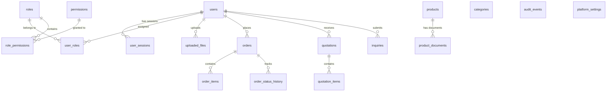

# B00 — Database Schema & Migration Audit

**Project:** PRIME by Activist — Unified Enterprise Platform  
**Target Database:** PostgreSQL 16+ (Production)  
**Development Database:** SQLite / `aiosqlite` (`unified_platform.db`)  
**ORM:** SQLAlchemy 2.0.36+ (Declarative Async)  
**Migration Tool:** Alembic 1.14+  
**Audit Date:** 2026-11-12  

---

## 1. Database Entity Overview

The application currently defines **18 database tables** (16 primary entities and 2 relational association tables) in `apps/api/app/database/models.py`.

---

## 2. Exhaustive Table Specifications

### 2.1 Identity & Access Control Subsystem

#### Table: `users`
- **Primary Key:** `id` (VARCHAR(36), UUIDv4).
- **Columns:**
  - `email`: VARCHAR(255), UNIQUE, NOT NULL, INDEXED.
  - `full_name`: VARCHAR(255), NOT NULL.
  - `password_hash`: VARCHAR(255), NOT NULL (Argon2id format).
  - `role`: VARCHAR(50), NOT NULL, DEFAULT `'customer'` (`'admin'`, `'staff'`, `'customer'`).
  - `account_type`: VARCHAR(100), NOT NULL, DEFAULT `'Individual Customer'`.
  - `phone`: VARCHAR(50), NULLABLE.
  - `country`: VARCHAR(100), NULLABLE.
  - `company_name`: VARCHAR(255), NULLABLE (Added in migration `54132424bde8`).
  - `business_address`: TEXT, NULLABLE (Added in migration `54132424bde8`).
  - `is_active`: BOOLEAN, NOT NULL, DEFAULT `TRUE`.
  - `is_verified`: BOOLEAN, NOT NULL, DEFAULT `FALSE`.
  - `token_version`: INTEGER, NOT NULL, DEFAULT `1` (Added in migration `a1c4e7f90123`).
  - `created_at`: TIMESTAMPTZ, NOT NULL, DEFAULT `utc_now`.
  - `last_login_at`: TIMESTAMPTZ, NULLABLE.
- **Relationships:** `sessions` (cascade delete-orphan), `roles` (secondary `user_roles`).
- **Defects / Gaps:** No `organization_id` FK. Multi-tenancy isolation cannot be enforced at the row level without an organization table.

#### Table: `user_sessions`
- **Primary Key:** `id` (VARCHAR(36), UUIDv4).
- **Columns:**
  - `family_id`: VARCHAR(36), NULLABLE, INDEXED (Added in migration `a1c4e7f90123`).
  - `user_id`: VARCHAR(36), NOT NULL, FK -> `users.id` (ON DELETE CASCADE).
  - `refresh_token_hash`: VARCHAR(255), UNIQUE, NOT NULL, INDEXED (SHA-256).
  - `user_agent`: VARCHAR(512), NULLABLE.
  - `ip_address`: VARCHAR(64), NULLABLE.
  - `expires_at`: TIMESTAMPTZ, NOT NULL.
  - `revoked_at`: TIMESTAMPTZ, NULLABLE.
  - `created_at`: TIMESTAMPTZ, NOT NULL, DEFAULT `utc_now`.
- **Integrity:** Strong. Implements token families for rotation reuse detection.

#### Table: `roles`
- **Primary Key:** `id` (VARCHAR(36), UUIDv4).
- **Columns:**
  - `name`: VARCHAR(100), UNIQUE, NOT NULL.
  - `slug`: VARCHAR(100), UNIQUE, NOT NULL, INDEXED.
  - `description`: VARCHAR(255), NOT NULL.
  - `is_system`: BOOLEAN, NOT NULL, DEFAULT `FALSE`.
  - `created_at`: TIMESTAMPTZ, NOT NULL, DEFAULT `utc_now`.
- **Relationships:** `permissions` (secondary `role_permissions`), `users` (secondary `user_roles`).

#### Table: `permissions`
- **Primary Key:** `id` (VARCHAR(36), UUIDv4).
- **Columns:**
  - `slug`: VARCHAR(100), UNIQUE, NOT NULL, INDEXED (e.g. `'orders.read'`, `'users.update'`).
  - `name`: VARCHAR(100), NOT NULL.
  - `module`: VARCHAR(50), NOT NULL, INDEXED.
  - `description`: VARCHAR(255), NOT NULL.

#### Association Tables:
- `user_roles`: `user_id` (FK -> `users.id` CASCADE), `role_id` (FK -> `roles.id` CASCADE). Composite PK.
- `role_permissions`: `role_id` (FK -> `roles.id` CASCADE), `permission_id` (FK -> `permissions.id` CASCADE). Composite PK.

---

### 2.2 Product Catalogue Subsystem

#### Table: `categories`
- **Primary Key:** `id` (VARCHAR(50), slug-id like `'tablets'`).
- **Columns:**
  - `name`: VARCHAR(100), UNIQUE, NOT NULL.
  - `slug`: VARCHAR(100), UNIQUE, NOT NULL, INDEXED.
  - `description`: VARCHAR(255), NULLABLE.
  - `image_url`: VARCHAR(255), NULLABLE.
  - `display_order`: INTEGER, DEFAULT `0`.
  - `created_at`: TIMESTAMPTZ, NOT NULL, DEFAULT `utc_now`.

#### Table: `products`
- **Primary Key:** `id` (VARCHAR(50), slug-id like `'tab-001'`).
- **Columns:**
  - `name`: VARCHAR(255), NOT NULL.
  - `category`: VARCHAR(100), NOT NULL, INDEXED.
  - `sku`: VARCHAR(50), UNIQUE, NOT NULL, INDEXED.
  - `product_code`: VARCHAR(50), NULLABLE.
  - `dosage_form`: VARCHAR(100), NULLABLE.
  - `strength`: VARCHAR(100), NULLABLE.
  - `composition`: TEXT, NULLABLE.
  - `pack_size`: VARCHAR(100), NOT NULL.
  - `description`: TEXT, NULLABLE, DEFAULT `''`.
  - `storage_conditions`: VARCHAR(255), NULLABLE.
  - `shelf_life`: VARCHAR(100), NULLABLE.
  - `image_url`: VARCHAR(255), NULLABLE.
  - `status`: VARCHAR(50), NOT NULL, DEFAULT `'Published'`.
  - `is_published`: BOOLEAN, NOT NULL, DEFAULT `TRUE`.
  - `created_at`: TIMESTAMPTZ, NOT NULL, DEFAULT `utc_now`.
  - `updated_at`: TIMESTAMPTZ, NOT NULL, DEFAULT `utc_now`.
- **Relationships:** `documents` (cascade delete-orphan).
- **Defect / Gap:** `category` column stores category name/slug as a raw string instead of a Foreign Key referencing `categories.id`. Lacks referential integrity on category renaming or deletion.

#### Table: `product_documents`
- **Primary Key:** `id` (VARCHAR(36), UUIDv4).
- **Columns:**
  - `product_id`: VARCHAR(50), NOT NULL, FK -> `products.id` (ON DELETE CASCADE).
  - `title`: VARCHAR(255), NOT NULL.
  - `document_type`: VARCHAR(100), NOT NULL (`'COA'`, `'Dossier'`, `'QC_Report'`).
  - `file_path`: VARCHAR(255), NOT NULL.
  - `file_size`: INTEGER, NULLABLE.
  - `created_at`: TIMESTAMPTZ, NOT NULL, DEFAULT `utc_now`.

#### Table: `uploaded_files`
- **Primary Key:** `id` (VARCHAR(36), UUIDv4).
- **Columns:**
  - `filename`: VARCHAR(255), NOT NULL.
  - `stored_filename`: VARCHAR(255), UNIQUE, NOT NULL, INDEXED (`<uuid>.<ext>`).
  - `file_path`: VARCHAR(512), NOT NULL.
  - `content_type`: VARCHAR(100), NOT NULL.
  - `file_size`: INTEGER, NOT NULL.
  - `category`: VARCHAR(100), NOT NULL, DEFAULT `'general'`.
  - `uploader_id`: VARCHAR(36), NULLABLE, FK -> `users.id` (ON DELETE SET NULL).
  - `created_at`: TIMESTAMPTZ, NOT NULL, DEFAULT `utc_now`.

---

### 2.3 Commercial, Orders & Procurement Subsystem

#### Table: `orders`
- **Primary Key:** `id` (VARCHAR(36), UUIDv4).
- **Columns:**
  - `order_number`: VARCHAR(50), UNIQUE, NOT NULL, INDEXED (`PRM-ORD-XXXX`).
  - `inquiry_id`: VARCHAR(36), NULLABLE.
  - `customer_id`: VARCHAR(36), NULLABLE, INDEXED, FK -> `users.id` (ON DELETE SET NULL).
  - `customer_name`: VARCHAR(255), NOT NULL.
  - `customer_email`: VARCHAR(255), NOT NULL, INDEXED.
  - `organization`: VARCHAR(255), NULLABLE.
  - `country`: VARCHAR(100), NOT NULL.
  - `status`: VARCHAR(50), NOT NULL, DEFAULT `'Submitted'`.
  - `assigned_admin_id`: VARCHAR(36), NULLABLE.
  - `total_estimated_amount`: VARCHAR(100), NULLABLE. **CRITICAL DEFECT: Stored as VARCHAR instead of Numeric(12, 2)**.
  - `delivery_terms`: VARCHAR(255), NULLABLE.
  - `internal_notes`: TEXT, NULLABLE.
  - `created_at`: TIMESTAMPTZ, NOT NULL, DEFAULT `utc_now`.
  - `updated_at`: TIMESTAMPTZ, NOT NULL, DEFAULT `utc_now`.
- **Relationships:** `items` (cascade delete-orphan), `status_history` (cascade delete-orphan).

#### Table: `order_items`
- **Primary Key:** `id` (VARCHAR(36), UUIDv4).
- **Columns:**
  - `order_id`: VARCHAR(36), NOT NULL, FK -> `orders.id` (ON DELETE CASCADE).
  - `product_id`: VARCHAR(50), NOT NULL.
  - `product_name`: VARCHAR(255), NOT NULL.
  - `sku`: VARCHAR(50), NOT NULL.
  - `quantity`: INTEGER, NOT NULL, DEFAULT `1`.
  - `target_pack_size`: VARCHAR(100), NULLABLE.
- **Defect:** `product_id` does not declare a formal Foreign Key to `products.id`.

#### Table: `order_status_history`
- **Primary Key:** `id` (VARCHAR(36), UUIDv4).
- **Columns:**
  - `order_id`: VARCHAR(36), NOT NULL, FK -> `orders.id` (ON DELETE CASCADE).
  - `previous_status`: VARCHAR(50), NOT NULL.
  - `new_status`: VARCHAR(50), NOT NULL.
  - `changed_by`: VARCHAR(255), NOT NULL.
  - `reason`: VARCHAR(500), NULLABLE.
  - `created_at`: TIMESTAMPTZ, NOT NULL, DEFAULT `utc_now`.

#### Table: `quotations`
- **Primary Key:** `id` (VARCHAR(36), UUIDv4).
- **Columns:**
  - `quotation_number`: VARCHAR(50), UNIQUE, NOT NULL, INDEXED (`PRM-QUO-XXXX`).
  - `order_id`: VARCHAR(36), NULLABLE.
  - `customer_id`: VARCHAR(36), NULLABLE, INDEXED, FK -> `users.id` (ON DELETE SET NULL).
  - `recipient_name`: VARCHAR(255), NOT NULL.
  - `recipient_email`: VARCHAR(255), NOT NULL.
  - `organization`: VARCHAR(255), NULLABLE.
  - `country`: VARCHAR(100), NOT NULL.
  - `status`: VARCHAR(50), NOT NULL, DEFAULT `'Draft'`.
  - `valid_until`: TIMESTAMPTZ, NOT NULL.
  - `currency`: VARCHAR(10), DEFAULT `'USD'`.
  - `total_amount`: FLOAT, DEFAULT `0.0`. **CRITICAL DEFECT: Stored as Float instead of Numeric(12, 2)**.
  - `commercial_terms`: TEXT, NULLABLE.
  - `created_by_user_id`: VARCHAR(36), NULLABLE.
  - `created_at`: TIMESTAMPTZ, NOT NULL, DEFAULT `utc_now`.
- **Relationships:** `items` (cascade delete-orphan).

#### Table: `quotation_items`
- **Primary Key:** `id` (VARCHAR(36), UUIDv4).
- **Columns:**
  - `quotation_id`: VARCHAR(36), NOT NULL, FK -> `quotations.id` (ON DELETE CASCADE).
  - `product_id`: VARCHAR(50), NOT NULL.
  - `product_name`: VARCHAR(255), NOT NULL.
  - `sku`: VARCHAR(50), NOT NULL.
  - `quantity`: INTEGER, NOT NULL, DEFAULT `1`.
  - `unit_price`: FLOAT, NOT NULL, DEFAULT `0.0`. **CRITICAL DEFECT: Stored as Float**.
  - `total_price`: FLOAT, NOT NULL, DEFAULT `0.0`. **CRITICAL DEFECT: Stored as Float**.

---

### 2.4 Inquiries, Audit & Settings

#### Table: `inquiries`
- **Primary Key:** `id` (VARCHAR(36), UUIDv4).
- **Columns:**
  - `reference_id`: VARCHAR(50), UNIQUE, NOT NULL, INDEXED (`PRIME-INQ-XXXX`).
  - `customer_id`: VARCHAR(36), NULLABLE, INDEXED, FK -> `users.id` (ON DELETE SET NULL).
  - `full_name`: VARCHAR(255), NOT NULL.
  - `email`: VARCHAR(255), NOT NULL, INDEXED.
  - `phone`: VARCHAR(50), NULLABLE.
  - `country`: VARCHAR(100), NOT NULL.
  - `organization`: VARCHAR(255), NULLABLE.
  - `enquiry_type`: VARCHAR(100), NOT NULL.
  - `subject`: VARCHAR(255), NOT NULL.
  - `message`: TEXT, NOT NULL.
  - `status`: VARCHAR(50), NOT NULL, DEFAULT `'Pending'`.
  - `assigned_admin_id`: VARCHAR(36), NULLABLE.
  - `internal_notes`: TEXT, NULLABLE.
  - `created_at`: TIMESTAMPTZ, NOT NULL, DEFAULT `utc_now`.
  - `updated_at`: TIMESTAMPTZ, NULLABLE, DEFAULT `utc_now`.

#### Table: `audit_events`
- **Primary Key:** `id` (VARCHAR(36), UUIDv4).
- **Columns:**
  - `user_id`: VARCHAR(36), NULLABLE, INDEXED.
  - `event_type`: VARCHAR(100), NOT NULL, INDEXED.
  - `description`: VARCHAR(500), NOT NULL.
  - `resource_type`: VARCHAR(50), NULLABLE, INDEXED.
  - `resource_id`: VARCHAR(100), NULLABLE, INDEXED.
  - `ip_address`: VARCHAR(64), NULLABLE.
  - `created_at`: TIMESTAMPTZ, NOT NULL, DEFAULT `utc_now`.

#### Table: `platform_settings`
- **Primary Key:** `key` (VARCHAR(100)).
- **Columns:**
  - `value`: TEXT, NOT NULL.
  - `description`: VARCHAR(255), NULLABLE.
  - `category`: VARCHAR(50), NOT NULL, DEFAULT `'general'`.
  - `updated_at`: TIMESTAMPTZ, NOT NULL, DEFAULT `utc_now`.
  - `updated_by_user_id`: VARCHAR(36), NULLABLE.

---

## 3. Alembic Migration Consistency & Defect Analysis

### Migration Chain Audit
1. `893632c08318` (`w08_schema_baseline_and_categories_files`):
   - Sets `down_revision = None`.
   - **Only creates `categories` and `uploaded_files`**.
   - `uploaded_files` declares a Foreign Key to `users.id`.
   - **FAILURE MODE**: On a fresh PostgreSQL database without prior tables, executing `alembic upgrade head` crashes with `foreign key constraint "uploaded_files_uploader_id_fkey" cannot be implemented: relation "users" does not exist`.
2. `54132424bde8` (`w09_workflow_schema_extensions`):
   - Creates `platform_settings`.
   - Adds columns to `audit_events`, `inquiries`, `users`.
   - Inspects existing tables dynamically using `sa.inspect(conn)`.
3. `a1c4e7f90123` (`w12_security_hardening_columns`):
   - Adds `customer_id` index to `orders`, `quotations`, `inquiries`.
   - Adds `token_version` to `users`.
   - Adds `family_id` to `user_sessions`.

### Root Cause
The core tables (`users`, `roles`, `permissions`, `products`, `orders`, `quotations`, etc.) were created using SQLAlchemy's `Base.metadata.create_all` in `session.py:init_db()`. Alembic was adopted later without generating an initial foundational baseline migration.

### Required Database Action for Roadmap B01
Generate a consolidated baseline migration script (`0001_initial_core_schema.py`) that declares all 18 tables explicitly with proper constraints, allowing clean standalone migrations on empty PostgreSQL production databases.

