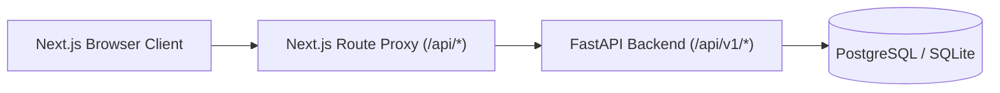

# B00 — Frontend-Backend Integration Gap Matrix

**Project:** PRIME by Activist — Unified Enterprise Platform  
**Frontend Stack:** Next.js 15.5.29, React 19, TypeScript  
**Backend Stack:** FastAPI 0.115+, Pydantic v2, Python 3.12  
**Audit Date:** 2026-11-12  

---

## 1. Architectural Integration Topology

The frontend communicates with the FastAPI backend through a dual-mode integration pattern:
1. **Client-Side (Browser):** Next.js API route handlers act as an internal gateway/proxy (`apps/web/src/app/api/*`) forwarding requests to FastAPI (`http://127.0.0.1:8000/api/v1/*`).
2. **Server-Side (SSR):** Next.js server components and route handlers communicate directly via `fetch()` with HTTP headers forwarded.

---

## 2. Comprehensive Endpoint Gap Matrix

| Frontend Module / Action | Frontend API Call | Expected Backend Endpoint | Actual Backend Implementation | Gap / Discrepancy Description | Severity | Remediation Roadmap |
| :--- | :--- | :--- | :--- | :--- | :--- | :--- |
| **Public Product Listing** | `productsApi.listPublic()` | `GET /api/v1/products` | `GET /api/v1/products` | Returns flat `list[ProductItemSchema]` without pagination (`total`, `page`, `limit`). | Medium | **B04** |
| **Public Product Detail** | `productsApi.get(id)` | `GET /api/v1/products/{id}` | `GET /api/v1/admin/products/{id}` | **CRITICAL AUTH MISMATCH**: Frontend calls admin endpoint. Anonymous visitors are blocked with 401/403. Public product detail endpoint is missing in backend. | **High** | **B04** |
| **Category Listing** | `productsApi.listCategories()` | `GET /api/v1/categories` | `GET /api/v1/categories` | Perfectly aligned. Both return `CategoryItem[]`. | None | **B04** |
| **Public Contact Enquiry** | `/api/contact` (Next.js) | `POST /api/v1/enquiries` | `POST /api/v1/enquiries` | Next.js sends camelCase (`fullName`, `enquiryType`). Backend handles via Pydantic alias `populate_by_name`. Functional, but requires normalization. | Low | **B06** |
| **Customer Order History** | `ordersApi.listCustomer()` | `GET /api/v1/auth/customer/orders` | `GET /api/v1/auth/customer/orders` | Aligned. Paginated response with customer ownership checks. | None | **B08** |
| **Customer Order Placement** | Shopping Cart Checkout | `POST /api/v1/customer/orders` | **NONE** (`POST /admin/orders` only) | **CRITICAL MISSING ENDPOINT**: Customers cannot submit or checkout orders online. Only admin staff can create orders. | **Critical** | **B08** |
| **Customer Quotation List** | `quotationsApi.listCustomer()` | `GET /api/v1/auth/customer/quotations` | `GET /api/v1/auth/customer/quotations` | Aligned. Customer ownership enforced. | None | **B07** |
| **Customer Quotation Request** | Request Quote from Cart | `POST /api/v1/customer/quotations/request` | **NONE** | **MISSING ENDPOINT**: B2B institutional buyers cannot request official commercial quotes directly from the cart. | **High** | **B07** |
| **Customer Quotation Action** | Accept / Decline Quotation | `POST /api/v1/customer/quotations/{id}/action` | **NONE** | **MISSING ENDPOINT**: Customers cannot digitally accept or sign off on quotes; only admins can patch quote status. | **High** | **B07** |
| **Admin Dashboard Stats** | `dashboardApi.getSummary()` | `GET /api/v1/admin/dashboard/summary` | `GET /api/v1/admin/dashboard/summary` | Aligned. Schema matches `DashboardSummary` in `types.ts`. | None | **B12** |
| **Admin Order Management** | `ordersApi.list()`, `updateStatus()` | `GET`, `PATCH /api/v1/admin/orders` | `GET`, `PATCH /api/v1/admin/orders` | Aligned. `total_estimated_amount` is typed as string on frontend and string in backend, but should be numeric. | Medium | **B08** |
| **Admin Quotation Engine** | `quotationsApi.create()`, `list()` | `POST`, `GET /api/v1/admin/quotations` | `POST`, `GET /api/v1/admin/quotations` | Functional, but float vs decimal precision risks on unit and total prices. | Medium | **B07** |
| **Admin Document Storage** | `documentsApi.upload()`, `list()` | `POST`, `GET /api/v1/admin/documents` | `POST`, `GET /api/v1/admin/documents` | Aligned. Multipart streaming upload and binary file download verified. | None | **B09** |
| **Admin User Management** | `usersApi.list()`, `suspend()` | `GET`, `POST /api/v1/admin/users/*` | `GET`, `POST /api/v1/admin/users/*` | Aligned. Role hierarchy and session revocation supported. | None | **B02** |
| **Admin RBAC Roles** | `rolesApi.list()`, `create()` | `GET`, `POST /api/v1/admin/roles` | `GET`, `POST /api/v1/admin/roles` | Aligned. Dynamic permission matrix operational. | None | **B03** |
| **Admin System Settings** | `settingsApi.get()`, `update()` | `GET`, `PATCH /api/v1/admin/settings` | `GET`, `PATCH /api/v1/admin/settings` | Aligned. Returns key-value pairs matching `SettingsResponse`. | None | **B14** |
| **Customer Notifications** | Header Notification Bell | `GET /api/v1/notifications` | **NONE** | **MISSING ENDPOINT**: Header has notification bell icon, but no backend notification service exists. | Medium | **B10** |
| **Live WhatsApp Support** | WhatsApp Chat Widget | `POST /api/v1/whatsapp/webhook` | **NONE** | **MISSING ENDPOINT**: No WhatsApp Business Cloud API integration exists. | Medium | **B11** |

---

## 3. Data Structure & Type Discrepancies

### 3.1 Field Naming and Aliasing
- **Public Contact Form:**
  - Frontend sends: `{ fullName, email, phone, country, organization, enquiryType, subject, message }`.
  - Backend receives: Pydantic aliases `fullName -> full_name`, `enquiryType -> enquiry_type`.
  - Database stores: `inquiries.full_name`, `inquiries.enquiry_type`.
  - *Recommendation:* Standardize frontend serializers to send snake_case uniformly, eliminating reliance on Pydantic field aliasing.

### 3.2 Monetary Value Inconsistencies
1. **Orders:**
   - Frontend `types.ts`: `total_estimated_amount?: string | null;`
   - Backend `Order`: `Column(String(100))`
   - *Impact:* Cannot perform database-level sum aggregations, financial audits, or currency calculations. Must be migrated to `Numeric(12, 2)` or `DECIMAL`.
2. **Quotations:**
   - Frontend `types.ts`: `total_amount: number;`
   - Backend `Quotation`: `Column(Float, default=0.0)`
   - Backend `QuotationItem`: `unit_price = Column(Float)`
   - *Impact:* Floating point representation causes precision drift (e.g. `19.99 * 3 = 59.970000000000006`). Must be migrated to `Numeric(12, 2)`.

### 3.3 Pagination Model Standardization
- **Admin Endpoints:** Return `{ items: [...], total: int, page: int, limit: int, total_pages: int }`.
- **Public Products Endpoint:** Returns a bare array `list[ProductItemSchema]`.
- *Recommendation:* Introduce an optional pagination query parameter for public products to protect backend memory as the SKU catalog scales beyond 1,000 items.

---

## 4. Frontend Integration Status Summary

- **Admin Backoffice Modules (100% Connected):**
  - Dashboard: `/admin` -> `GET /api/v1/admin/dashboard/summary` (Live)
  - Products: `/admin/products` -> CRUD `/api/v1/admin/products` (Live)
  - Orders: `/admin/orders` -> List/Status/Assign `/api/v1/admin/orders` (Live)
  - Quotations: `/admin/quotations` -> Create/Status `/api/v1/admin/quotations` (Live)
  - Enquiries: `/admin/enquiries` -> List/Update `/api/v1/admin/enquiries` (Live)
  - Users: `/admin/users` -> List/Suspend/Activate `/api/v1/admin/users` (Live)
  - Roles: `/admin/roles` -> List/Create/Permissions `/api/v1/admin/roles` (Live)
  - Documents: `/admin/documents` -> Upload/List/Download `/api/v1/admin/documents` (Live)
  - Settings: `/admin/settings` -> Get/Update `/api/v1/admin/settings` (Live)
- **Public & Customer Modules (75% Connected):**
  - Authentication & Profile: Live.
  - Public Catalog Listing: Live.
  - Public Contact Form: Live.
  - Customer Order/Quote History: Live.
  - Customer Online Checkout: **Blocked by missing backend endpoint**.
  - Customer Quote Acceptance: **Blocked by missing backend endpoint**.

